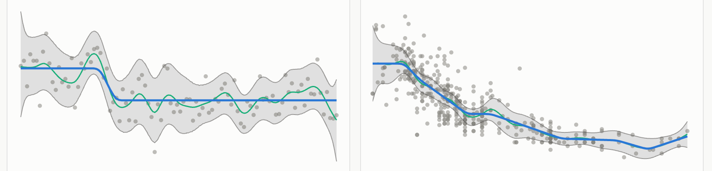

# lafspline: Least Ambitious Fit using P-splines

**Live:** https://xangregg.github.io/lafspline/

lafspline finds the simplest curve the data allow. It works in two phases, both with P-splines (B-splines on
equally spaced knots with a penalty on the differences of their coefficients):

1. **A confidence region** for the regression function, from the data alone: a bootstrap band (the default) or a
   P-spline band around a first P-spline fit, or Aₙ, the multiresolution region of Davies, Kovac & Meise, which
   bounds the residuals' sums over intervals at every scale.
2. **The Least Ambitious Fit**: a second P-spline, penalized severely for leaving the region, slightly for its
   distance from the region's center, and for *ambition*, its departure from a straight line or a constant. The
   ambition can be the squared differences, the number of bends or steps, shaped bends (that number with costs for
   rounding, extremes and inflections), or the differences' sizes to a power.

Every fit reports which region it was checked against, whether it stays inside, and what the region covers under
which assumptions; approximate methods say so. The page's ⓘ tips and its About panel explain each setting.

It runs entirely in the browser: no server, no build step, no data leaves the page. Choose an example data set or
a simulated signal, or paste or drop your own CSV. Settings live in the address bar, so a link shares a view; the
Gallery shows several data sets with the same settings; Export saves the data and fits as CSV, the chart as SVG,
PNG or JPEG, and the fit built up step by step as an animated GIF or SVG.

## Details

### The fit and its ambition

The phase-2 fit is a cubic P-spline g = Bβ on a fine check grid. It minimizes

    κ · Σ dist(g, region)² / h²  +  ε · Σ ((g − c) / h)²  +  a · ambition(β)

where c and h are the region's center and half-width at each grid point (for Aₙ, each term is one interval instead:
a box for the fit's mean over it). The first term makes the region nearly
hard (κ = 10⁴); the second is a slight pull toward the center (ε = 10⁻²) that also makes the fit unique. The
ambition weight a is set relative to **a\***, the largest ambition at which the fit still stays inside the region (to
within 1% of its half-width): the knob is in decades from a\*, so 0 is the simplest fit inside on any data set, lower
values follow more detail, and higher ones give up on the region. All terms are scaled by the region's median
half-width, so the knob means the same whatever the units, the number of segments or the grid density.

"Ambition" is departure from a straight line (second differences of β) and, with a share toward flat (15% by
default), from a constant (first differences). How it is counted is the choice of penalty.

### Shaped bends (the default penalty)

The starting point is the **number** of bends: each nonzero second difference of β costs the same, so the fit is
made of exactly straight pieces joined by bends. The count is approximated by the adaptive ridge (Frommlet & Nuel
2016): iteratively reweighted squared differences, weights 1/(d² + δ²), followed by an exact refit with the chosen
differences pinned to zero and backward elimination of joins that do not pay for themselves. That is a local
optimum, not a proven minimum, and the readouts say so.

A plain count has two faults. Since every bend costs the same, the cheapest way to turn is all at once, so the top of
a wave becomes a sharp corner. And it is blind to shape: a fit that rises, peaks and falls back costs the same as
one that rises and levels off, though the second is the less ambitious claim. Shaped bends price each bend, a run of
consecutive nonzero second differences, by its shape:

- **Rounding.** Each bend also pays q·Σd² for its second differences d. A turn T spread over m differences then
  costs about c·m + q·T²/m, least at a constant curvature, so a bend widens with how far it turns while a small turn
  stays short. q is set so that a bend leaves its tangent line by one median half-width of the region over the
  *bend length* (5% of the x range by default), whatever the number of segments. The rounding cost levels off at
  0.2·(range of the center / median half-width)², so a turn the region forces to be sharp, such as a spike narrower
  than the bend length, costs at most about that much instead of dominating the fit and tilting the straight pieces
  beside it.
- **Extremes.** A bend whose two sides slope in opposite directions (a local maximum or minimum) costs 2 more plain
  bends. A straight piece that rises less than 5% of a half-width counts as level, so rising and leveling off is not
  an extremum.
- **Inflections.** Each change in the direction of bending costs 1 more plain bend, which discourages wiggles even
  where the fit keeps rising.

The reweighting cannot trade an extremum or an inflection away, since the refit takes the signs of the differences
from the region. So a shape search reruns the fit with sign constraints, a stretch kept monotone or bending one way,
and keeps any rerun that lowers the whole objective; a candidate is first screened by its fit with no ambition, and
skipped if that already leaves the region or costs more. The search is greedy, so this too is a local optimum.

With a share toward flat, steps (nonzero first differences) are counted as in the plain count, and the corners of a
step no longer than the bend length are not rounded (rounding them would only shorten the step); the bends of longer
slopes are. With all three shape costs at 0 the penalty is exactly the number of bends (a test checks this). The
readouts give the pieces and bends, the widest bend, the extremes and inflections, and how many shape candidates
were tried and kept.

### The other penalties

- **Squared differences**: the usual P-spline penalty, ‖D₂β‖² (and ‖D₁β‖² for the share toward flat). Straighter
  everywhere, smoothly; no piece is exactly straight. Solved by iterated weights on the points outside the region
  (Bollaerts, Eilers & Van Mechelen 2006), the exact minimizer when the iteration settles.
- **Number of bends or steps**: the plain count above, without the shape costs: straight (or flat) pieces joined by
  short bends (or steps).
- **|Second differences|^q**: Σ|D₂β|^q for 0 < q ≤ 2, by majorize-minimize. q = 2 is the squared differences, q = 1
  is ℓ₁ trend filtering (straight pieces and kinks; convex), and toward 0 the count of bends (not convex: a local
  minimum).

### The regions

- **Bootstrap band** (the default): a simultaneous band around a P-spline fit, from B refits with random fractional
  weights on the observations (distributed like resampled counts in mean, variance and skewness, or Dirichlet, the
  Bayesian bootstrap). The replicates are studentized and the band reaches below and above the fit by their lower
  and upper tails, so it can be asymmetric and wider where the noise is. It covers the P-spline's mean, f smoothed
  by the same penalty, at every grid point at once with probability about α; the noise need not be Gaussian.
- **P-spline band**: a simultaneous band from the P-spline's Bayesian covariance, with its critical value by Monte
  Carlo. It covers f itself if f is smooth and the noise independent Gaussian. With the sandwich covariance instead,
  it covers the P-spline's mean, as the bootstrap band does, for independent Gaussian noise.
- **Aₙ** (Davies, Kovac & Meise 2009): every interval I of a family must satisfy |Σ_I (y − g)| ≤ c·√|I|, with
  c = σ̂·√(τ log n), σ̂ from differences of neighboring y and τ calibrated by Monte Carlo for coverage α. The family
  is the paper's dyadic blocks with lengths doubling; by default blocks spanning less than 5% of the x range are
  merged, so Aₙ answers only to features at least that wide. It assumes nothing about the smoothness of f, but more
  than the bands about the noise: skewed or unequal noise lowers its coverage far more.

For both bands, λ comes from a **feature scale**, the shortest features of interest as a share of the x range (10%
by default): λ is set so that a sine of that period keeps half its amplitude through the smoother, so the same scale
means the same on every data set. GCV (undersmoothed), AIC, two rules of thumb and a given λ are the alternatives.
Coverage figures from simulations (`tools/sim-band.mjs`, `tools/sim-an.mjs`) are cited in each region's claim.

## File layout

- `src/core/`: the algorithms, pure JavaScript that runs unchanged in Node and the browser (P-splines, the bands,
  Aₙ, the phase-2 fits, the GIF encoder).
- `src/ui/`: the page (charts with d3, controls, readouts, link state, exports).
- `data/`: the example data sets, CSV with `# label:` and `# source:` lines; see `data/README.md` to add one.
- `test/`: `node:test` tests, some against fixtures computed in R.
- `tools/`: simulations and checks behind the coverage figures the page cites, and a headless-Chrome page check.
- `PLAN.md`: the design, decisions and studies; `VENDORED.md`: code adapted from the earlier project it follows.

## Data

The example data sets are third-party measurements, included for demonstration with their sources cited in each
file and shown with every fit. They are not covered by lafspline's license; their own terms apply.

## Credits

lafspline follows [tautfit](https://github.com/xangregg/tautfit), an implementation of P. L. Davies, A. Kovac and
M. Meise (2009), *Ann. Statist.* 37(5B):2597–2625. P-splines after P. H. C. Eilers and B. D. Marx (1996), *Statist.
Sci.* 11(2):89–121, and their book *Practical Smoothing: The Joys of P-splines* (2021). Further references are in
the About panel and PLAN.md.

## License

[0BSD](LICENSE). The vendored HiGHS build in `vendor/highs/` is under its own MIT license.
